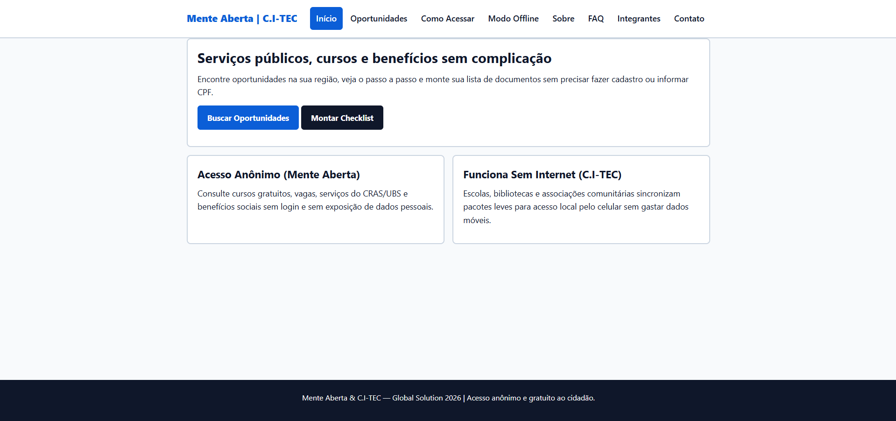

# Mente Aberta — Guia de Serviços Públicos, Cursos e Oportunidades

Portal web cidadão desenvolvido para a **Global Solution 2026 (FIAP)** com foco em inclusão digital, acesso simplificado à informação pública e apoio a comunidades com conectividade limitada.



---

## Sobre o Projeto

Muitos cidadãos enfrentam barreiras para acessar cursos gratuitos, vagas de emprego, atendimentos de saúde (UBS/CRAS) e benefícios sociais por conta de plataformas complexas, excesso de termos técnicos, exigência imediata de cadastro ou falta de internet estável.

O **Mente Aberta** resolve esse problema oferecendo uma interface leve, responsiva, anônima (sem exigência de login ou CPF) e preparada para sincronização em pontos comunitários com acesso local offline.

---

## Funcionalidades Implementadas

* **Página Inicial Orientada por Categorias (`index.html`):** Banner principal com ilustração vetorial em SVG e atalhos visuais para cursos, saúde/CRAS, vagas/renda e documentação.
* **Catálogo com Busca e Filtros em Tempo Real (`oportunidades.html`):** Pesquisa por palavra-chave com normalização de acentos e filtros combinados por categoria e perfil do cidadão.
* **Guia Passo a Passo e Checklist Interativo (`como-acessar.html`):** Integração via parâmetro de URL (`?id=`) para exibir instruções oficiais e lista interativa de documentos com contador dinâmico de progresso.
* **Módulo Offline Comunitário (`modo-offline.html`):** Consulta de pontos locais (escolas, bibliotecas e associações) que disponibilizam pacotes leves para acesso sem consumo de dados móveis.
* **Acessibilidade Integrada (`js/main.js` e `css/style.css`):**
  * Barra flutuante persistente (`localStorage`) com ajuste de tamanho de fonte (**A+ Texto**) e modo **Alto Contraste**.
  * Navegação por teclado, *skip link* para conteúdo principal, atributos ARIA (`aria-current`, `aria-expanded`, `aria-pressed`) e suporte a `prefers-reduced-motion`.
* **Páginas Institucionais e Contato (`sobre.html`, `faq.html`, `integrantes.html`, `contato.html`):** Apresentação da solução, perguntas frequentes em linguagem acessível, dados da equipe e formulário com validação completa em JavaScript.

---

## Identidade Visual e Padrões Técnicos

* **Paleta de Cores:** Verde Esmeralda (`#047857` / `#064e3b`), Verde-Petróleo (`#0f766e`) e Fundo Gelo (`#f4f7f6`), garantindo alto contraste e legibilidade.
* **Marca Vetorial:** Logotipo e *favicon* desenvolvidos em SVG (`assets/img/logo.svg`) para carregamento instantâneo sem perda de qualidade.
* **CSS3 Puro e Modular:** Estilização centralizada exclusivamente em `css/style.css` utilizando variáveis CSS (`:root`), Flexbox, CSS Grid, Media Queries (*mobile-first*) e animações suaves (`@keyframes`), sem estilos inline e sem frameworks externos.

---

## Estrutura de Pastas

```text
mente-aberta/
├── assets/
│   └── img/
│       ├── logo.svg
│       └── preview.png
├── css/
│   └── style.css
├── js/
│   ├── checklist.js
│   ├── contato.js
│   ├── dados.js
│   ├── main.js
│   └── oportunidades.js
├── como-acessar.html
├── contato.html
├── faq.html
├── index.html
├── integrantes.html
├── modo-offline.html
├── oportunidades.html
├── sobre.html
└── README.md

```

## Tecnologias Utilizadas

HTML5 (estrutura semântica e acessível)

CSS3 (variáveis, Grid, Flexbox, Media Queries e animações)

JavaScript Vanilla (ES6+) (manipulação do DOM, filtros dinâmicos, validação de formulários e localStorage)


## Como Executar o Projeto
Clone este repositório ou extraia o arquivo .ZIP do projeto:

Bash

git clone [https://github.com/GabrielHenriqueDantas/mente-aberta-citec]

Acesse a pasta do projeto e abra o arquivo index.html diretamente no navegador (ou utilize a extensão Live Server no Visual Studio Code).

## Integrantes do Grupo

Gabriel Henrique Dantas Matos — RM576855 | Turma: [INSERIR_TURMA] | GitHub

João Paseto — RM576879 | Turma: [INSERIR_TURMA] | [LINK_GITHUB_OU_LINKEDIN]

Kaio César — RM575944 | Turma: [INSERIR_TURMA] | [LINK_GITHUB_OU_LINKEDIN]

## Repositório e Declaração de Uso de Inteligência Artificial

Repositório Público: [https://github.com/GabrielHenriqueDantas/mente-aberta-citec]

Uso de IA Generativa: Ferramentas de Inteligência Artificial foram utilizadas como apoio para revisão de acessibilidade (WCAG), refinamento da folha de estilos CSS3, estruturação de textos em linguagem simples e organização da documentação técnica. Todo o código foi revisado, integrado e validado pelos integrantes da equipe.